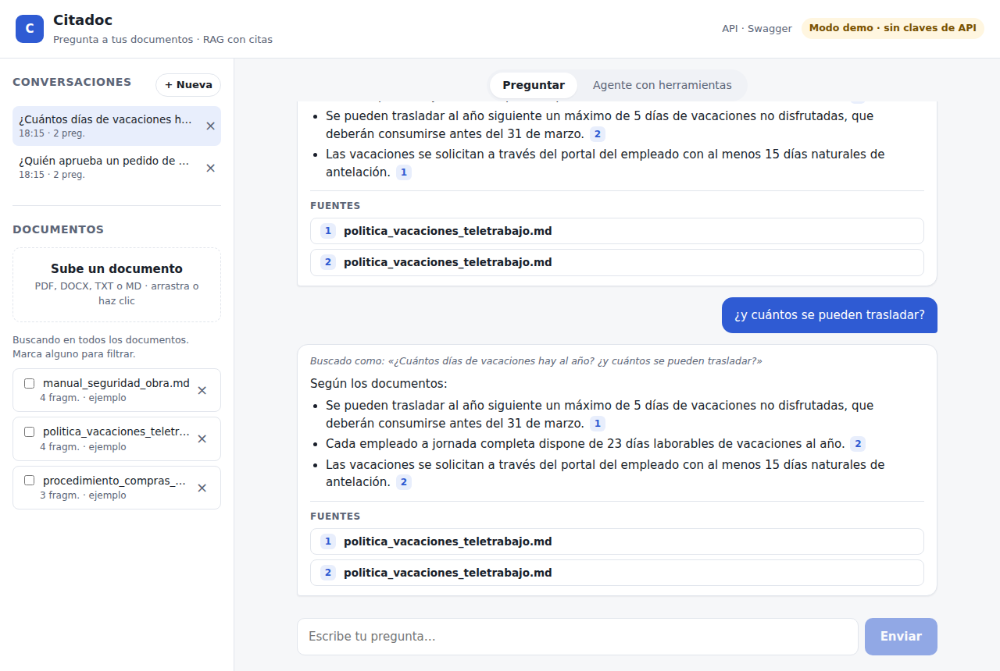
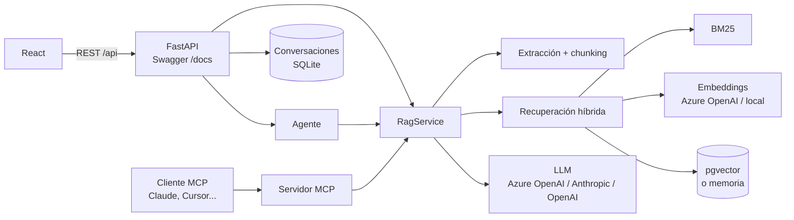

# Citadoc · Aplicación RAG full stack con citas a la fuente

Subes PDF, DOCX o TXT; el backend extrae el texto, lo divide en fragmentos (*chunks*), genera embeddings y los guarda en **pgvector**. Cada pregunta recupera los fragmentos más relevantes y **Azure OpenAI** responde citando las fuentes. Las conversaciones son persistentes y la API está documentada con **Swagger**.

**Stack:** Python 3.11 · FastAPI · React 18 + Vite · PostgreSQL + pgvector · Azure OpenAI (o Anthropic / OpenAI) · MCP · Docker · GitHub Actions



## Qué hace

- **Ingesta** de PDF (conservando el número de página), DOCX (incluidas tablas), TXT y Markdown.
- **Chunking recursivo** por párrafos y frases con solapamiento, para no cortar ideas por la mitad.
- **Embeddings en pgvector** con índice HNSW y distancia coseno (o un índice en memoria para desarrollo).
- **Búsqueda híbrida:** BM25 (palabras exactas: importes, códigos, nombres) + búsqueda vectorial (significado), fusionadas con *Reciprocal Rank Fusion*.
- **Respuestas con citas** `[1]`, `[2]` que en la interfaz abren el fragmento original. Las citas a fuentes que no existen se eliminan.
- **Control de alucinaciones:** si los fragmentos recuperados no cubren la pregunta, responde "No encuentro esa información en los documentos." sin llamar al modelo.
- **Conversaciones persistentes** con preguntas de seguimiento: "¿y cuántos se pueden trasladar?" se reescribe como pregunta completa usando el historial antes de buscar.
- **Agente con herramientas:** decide si listar, buscar, resumir o comparar documentos, y muestra cada paso.
- **Servidor MCP:** la misma base documental como herramientas para Claude Desktop, Claude Code, Cursor o VS Code.
- **API documentada** con Swagger en `/docs` y ReDoc en `/redoc`.
- **Modo demo sin claves de API:** embeddings locales y respuestas extractivas, para que la demo pública funcione siempre y sin coste.

## Arquitectura



El código sigue una idea de **puertos y adaptadores**: `Embedder`, `VectorStore` y `LLM` son interfaces, y `container.py` es el único sitio que elige las implementaciones concretas. Cambiar de proveedor o de base de datos es configuración, no código.

**Flujo de una pregunta:** reescribir si es de seguimiento → recuperar (BM25 + vectores → RRF) → comprobar que hay base suficiente → generar con citas → validar citas → guardar en la conversación.

## Evaluación

`python -m eval.run_eval` mide la recuperación y las respuestas sobre los documentos de ejemplo (14 preguntas con respuesta y 4 fuera de tema). Se ejecuta también en cada push en CI.

| Estrategia | hit@1 | hit@3 | MRR |
|---|---|---|---|
| Solo BM25 | 0,93 | 1,00 | 0,96 |
| Solo vectores | 1,00 | 1,00 | 1,00 |
| **Híbrida (RRF)** | **1,00** | **1,00** | **1,00** |

Modo demo: 14/14 respuestas contienen el dato esperado y 4/4 preguntas fuera de tema se rechazan.

Con solo tres documentos es una prueba pequeña: sirve para detectar regresiones, no para comparar modelos. Los umbrales del control de alucinaciones se ajustaron con este mismo conjunto y conviene recalibrarlos con documentos reales.

## Ejecutar

**Todo con Docker, con PostgreSQL + pgvector:**

```bash
cp .env.example .env        # opcional: claves de Azure OpenAI
docker compose up --build   # http://localhost:8000  ·  Swagger en /docs
```

**Solo la aplicación (índice en memoria):**

```bash
docker build -t citadoc .
docker run -p 8000:8000 citadoc
```

**En local, para desarrollar:**

```bash
cd backend
pip install -r requirements-dev.txt
uvicorn app.main:app --reload          # http://localhost:8000/docs

cd frontend
npm install
npm run dev                            # http://localhost:5173
```

Arranca en modo demo con tres documentos de ejemplo (ficticios) ya cargados.

### Azure OpenAI

En `.env`:

```bash
CITADOC_LLM_PROVIDER=azure
CITADOC_EMBEDDING_PROVIDER=azure
CITADOC_AZURE_OPENAI_ENDPOINT=https://<recurso>.openai.azure.com
CITADOC_AZURE_OPENAI_API_KEY=...
CITADOC_AZURE_OPENAI_CHAT_DEPLOYMENT=gpt-4o-mini
CITADOC_AZURE_OPENAI_EMBEDDING_DEPLOYMENT=text-embedding-3-small
```

También funciona con Anthropic (`CITADOC_LLM_PROVIDER=anthropic`) o cualquier API compatible con OpenAI, como OpenAI u OpenRouter (`CITADOC_LLM_PROVIDER=openai`). Todas las opciones están en `.env.example`.

## Usar los documentos desde Claude (MCP)

```json
{
  "mcpServers": {
    "citadoc": {
      "command": "python",
      "args": ["-m", "app.mcp_server"],
      "cwd": "/ruta/a/citadoc/backend"
    }
  }
}
```

Herramientas: `list_documents`, `search_documents`, `ask_documents`, `summarize_document`.

## API

Documentación interactiva en `/docs` (Swagger) y `/redoc`.

| Método | Ruta | Descripción |
|---|---|---|
| GET | `/api/health` | Modo (demo o LLM), embeddings, índice y nº de documentos |
| GET | `/api/documents` | Lista de documentos |
| POST | `/api/documents` | Subir un documento (multipart, máx. 10 MB) |
| DELETE | `/api/documents/{id}` | Eliminar un documento del índice |
| POST | `/api/ask` | Pregunta con citas; `doc_ids` y `conversation_id` opcionales |
| POST | `/api/agent` | Petición al agente; devuelve los pasos y las fuentes |
| GET | `/api/conversations` | Lista de conversaciones |
| GET | `/api/conversations/{id}` | Conversación con sus mensajes y fuentes |
| DELETE | `/api/conversations/{id}` | Eliminar una conversación |

## Tests y calidad

```bash
cd backend
ruff check .
pytest -q
```

38 tests: ingesta, chunking, BM25, búsqueda híbrida, RAG con citas, control de alucinaciones, preguntas de seguimiento, agente, API, conversaciones, MCP y los contratos HTTP de Azure OpenAI, Anthropic y OpenAI. El test de pgvector se ejecuta si hay base de datos (`CITADOC_TEST_DATABASE_URL`); en CI se levanta con la imagen `pgvector/pgvector`. El pipeline también compila el frontend, construye la imagen Docker y comprueba que arranca.

## Estructura

```
backend/
  app/
    ingestion/        extracción (PDF, DOCX, TXT, MD) y chunking
    retrieval/        tokenizador, BM25, embeddings, vector stores, búsqueda híbrida
    llm/              proveedores (Azure OpenAI, Anthropic, OpenAI-compatible)
    rag/              servicio RAG y prompts
    agent/            agente con herramientas
    conversations.py  historial persistente
    main.py           API FastAPI
    mcp_server.py
  eval/               conjunto de evaluación y script
  sample_docs/        documentos ficticios de ejemplo
  tests/
frontend/             React + Vite
```

## Limitaciones conocidas

- Los embeddings del modo demo son léxicos (palabras y fragmentos de palabras), no semánticos: "paga" no encuentra "abona". Con Azure OpenAI u OpenAI se usan embeddings semánticos.
- En modo demo la respuesta es extractiva (frases literales de los documentos); la redacción natural la hace el LLM cuando hay clave.
- PDF escaneados: no hay OCR, solo texto extraíble.
- Las conversaciones se guardan en SQLite: suficiente para una instancia; con varias réplicas irían a PostgreSQL.
